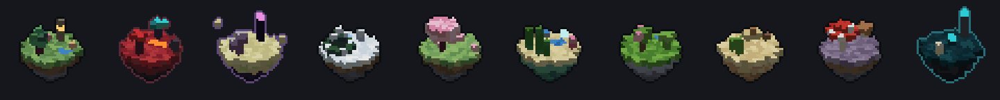
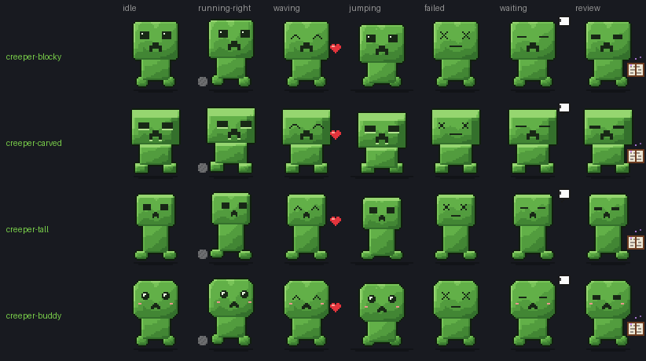
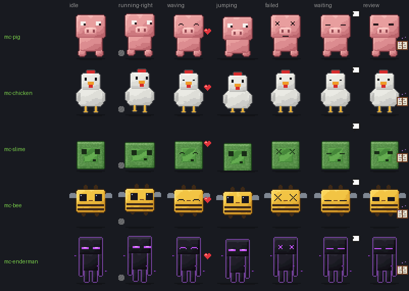
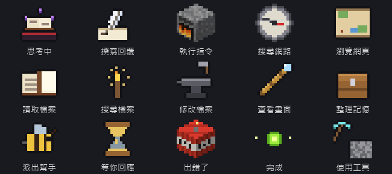
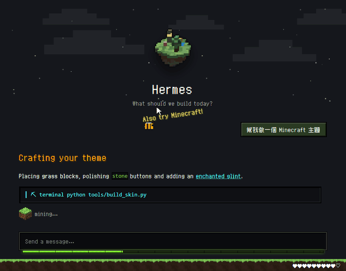

<div align="center">

**English** | [繁體中文](README.md)

# ⛏ Hermes × Minecraft

An unofficial Minecraft-style theme for [Hermes Agent](https://github.com/NousResearch/hermes-agent): ten animated worlds, mobs that roam the window, and icons that change with what Hermes is doing.


<sub>Illustration: the plugin's real background and mobs, recorded over a mock page. Not a screenshot of the actual Hermes app.</sub>

</div>

## Install & update

**Windows (PowerShell)**

```powershell
irm https://raw.githubusercontent.com/XiaoJunX1005/hermes-minecraft-theme/main/install.ps1 | iex
```

**macOS / Linux / WSL / Git Bash**

```bash
curl -fsSL https://raw.githubusercontent.com/XiaoJunX1005/hermes-minecraft-theme/main/install.sh | bash
```

The first install applies the `minecraft` world and the `creeper-blocky` pet. Running it again updates everything and keeps your current choices.

## Worlds

```bash
hermes config set display.skin minecraft-nether
```

You can also pick one under Appearance in the desktop app. By default the world changes every 4–8 minutes; press Ctrl+K (⌘K) and search "Minecraft" to turn that off or switch right away.



| Skin | World | On the floating island |
|---|---|---|
| `minecraft` | Overworld | Trees, a small pond, a lamp |
| `minecraft-nether` | Nether | Lava pool, crimson and warped fungi, basalt |
| `minecraft-end` | The End | Obsidian pillars with End crystals, chorus plants |
| `minecraft-snow` | Snowy Plains | Spruce, ice, a lamp |
| `minecraft-cherry` | Cherry Grove | Cherry trees, falling petals, a pond |
| `minecraft-ocean` | Deep Ocean | Sand, kelp, coral, sea lanterns |
| `minecraft-lush` | Lush Caves | Moss, azalea, dripleaf, glow berries |
| `minecraft-desert` | Desert | Cactus, dead bushes, sandstone ruins |
| `minecraft-mushroom` | Mushroom Fields | Mycelium, huge red and brown mushrooms |
| `minecraft-deepdark` | Deep Dark | Sculk, sculk sensors, ancient city pillars |

Each world also has its own animated background (one of three layouts, picked at random) and its own mobs: bees and allays in the Overworld, ghasts and blazes in the Nether, the Ender Dragon or shulkers in The End, axolotls in the Lush Caves, the Warden in the Deep Dark, and more. Full list in the [details page (Chinese)](docs/DETAILS.md#會動的世界).

## Pets

```bash
hermes pets select mc-bee
hermes pets off          # turn the pet off
```





| Pet | Description |
|---|---|
| `creeper-blocky` | Creeper: boxy chibi (default) |
| `creeper-carved` | Creeper: sharp edges, recessed face |
| `creeper-tall` | Creeper: close to in-game proportions |
| `creeper-buddy` | Creeper: round chibi with blush |
| `mc-pig` | Pig |
| `mc-chicken` | Chicken |
| `mc-slime` | Slime |
| `mc-bee` | Bee |
| `mc-enderman` | Enderman |
| `lantern-buddy` | An original little lantern |

## Activity icons



Provided by the bundled desktop plugin. It reads the work events the desktop app receives (which tool started or finished, whether Hermes is waiting for your approval) and never reads your conversation. The icons appear in two places:

- **Status bar**: icon plus a label such as "Reading file"; shows "×2" when several tools run at once.
- **The "thinking" row in the chat**: replaced with the matching icon.

| Icon | Shown when |
|---|---|
| Enchanted book | Thinking (before the reply starts) |
| Quill | Writing the reply |
| Furnace | Running terminal commands or code |
| Compass | Searching the web |
| Treasure map | Reading web pages, driving a browser |
| Book | Reading files or skills |
| Torch | Searching project files |
| Anvil | Creating or editing files |
| Spyglass | Looking at images or the screen |
| Chest | Memory, to-do lists, schedules |
| Bee | Delegating to a subagent |
| Hourglass | Waiting for your approval or answer |
| TNT | An error (shown for 3 s) |
| XP orb | Done (shown for 1.5 s) |
| Pickaxe | Any other tool (e.g. MCP tools) |

## Annoy a bee



Move the cursor close to the same bee and away again three times within 8 seconds: it turns angry, charges the cursor, stings, bounces back and flies off. It's purely visual and never affects your mouse or clicks. It never attacks when "reduce motion" is on.

## Restore

```bash
hermes config set display.skin default
hermes pets off
```

## License

- Code and the project's own artwork: MIT, see [LICENSE](LICENSE).
- [Zpix](https://github.com/SolidZORO/zpix-pixel-font) font: **free for personal and educational use; commercial use requires a license from its author**. This project only loads it from a CDN and does not ship the font files.
- An unofficial fan project, not affiliated with Mojang Studios or Microsoft. Minecraft is a trademark of Mojang Synergies AB.

<sub>Want to modify the theme or regenerate the art? See the [development notes (Chinese)](docs/DEVELOPMENT.md).</sub>
