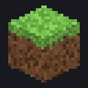

<div align="center">

# ⛏ Hermes × Minecraft Theme

**一個 Minecraft 風格、會動的 [Hermes Agent](https://github.com/NousResearch/hermes-agent) 主題**
An animated, Minecraft-style skin for Hermes Agent — desktop app, TUI and CLI from one file.


</div>

## ✨ 特色 Features

| | 動畫 / 效果 |
|---|---|
| 🧱 **旋轉草方塊** | 新對話畫面中央有一顆 3D 草方塊在旋轉、漂浮（純 Python 光線投射算出的像素畫） |
| 🌌 **夜空** | 對話背景有閃爍的星星與緩慢飄動的方塊雲 |
| 🟩 **經驗值條** | Hermes 回覆時，輸入框下方會出現跑動的 XP 條 |
| ⛏ **挖礦中…** | 「思考中」指示器換成迷你旋轉方塊 |
| 💜 **附魔光澤** | 你的訊息泡泡有紫色附魔光掃過 |
| 🌱 **草地狀態列** | 底部狀態列是一排草方塊，寵物就走在上面 |
| 🪨 **石頭按鈕** | 按鈕是石材紋理 + 立體斜角，滑過變 Minecraft 藍 / 黃字 |
| 🗨 **標題畫面標語** | 黃色跳動的 splash text「Also try Minecraft!」 |
| 🔤 **像素字型** | [Pixelify Sans](https://fonts.google.com/specimen/Pixelify+Sans)（中文自動回退到微軟正黑體） |
| 🐸 **Creeper Buddy 寵物** | 9 種動畫狀態：待機、跑步、揮手（冒愛心）、跳躍、失敗（閃白快爆炸）、等待（對話泡泡）、閱讀附魔書 |
| 💻 **CLI / TUI** | 草地→泥土→石頭漸層 Logo、Creeper 頭像、方塊破壞進度 spinner、「mining / crafting / enchanting…」 |

所有方塊、紋理與寵物都是程式即時產生的原創像素畫（不含任何 Mojang 素材）。

<div align="center">




</div>

## 📦 安裝 Install

**一行指令（Windows PowerShell）**

```powershell
irm https://raw.githubusercontent.com/XiaoJunX1005/hermes-minecraft-theme/main/install.ps1 | iex
```

**一行指令（macOS / Linux / WSL / Git Bash）**

```bash
curl -fsSL https://raw.githubusercontent.com/XiaoJunX1005/hermes-minecraft-theme/main/install.sh | bash
```

**手動**

1. 把 [`skins/minecraft.yaml`](skins/minecraft.yaml) 複製到 Hermes home 的 `skins/` 資料夾
   - Windows：`%LOCALAPPDATA%\hermes\skins\`
   - macOS / Linux：`~/.hermes/skins/`
2. （可選）把 [`pets/creeper-buddy/`](pets/creeper-buddy) 整個資料夾複製到 `pets/`
3. 套用：

```bash
hermes config set display.skin minecraft
hermes pets select creeper-buddy   # 可選：啟用寵物
```

所有介面（桌面版 / TUI / CLI）會在一秒內即時換膚，不需重開。

**還原：** `hermes config set display.skin default`，寵物 `hermes pets off`。

## 🛠 開發 Development

主題由原始碼產生，請改 `src/` 而不是直接改 `skins/minecraft.yaml`：

```
src/skin.base.yaml     調色盤、spinner、品牌文字、tool emoji
src/desktop.css        桌面版 customCSS（動畫都在這裡）
tools/pixels.py        共用像素紋理（草、泥土、creeper）
tools/build_skin.py    → skins/minecraft.yaml + docs/grass-block.gif
tools/make_pet.py      → pets/creeper-buddy/ + docs/pet-preview.gif
tools/make_preview.py  → docs/preview.html（可在瀏覽器直接開來看效果）
tools/record_gif.py    → docs/preview.gif（需要 Chrome 或 Edge）
```

```bash
pip install pillow
python tools/make_pet.py
python tools/build_skin.py --install   # 產生並安裝到本機 Hermes、立即套用
python tools/make_preview.py && python tools/record_gif.py
```

注意：Hermes 對 `customCSS` 有 32 KiB 上限，`build_skin.py` 超過時會直接報錯。
系統設定「減少動態效果」時，所有動畫會自動停止。

## 📄 License

MIT © 2026 — 非官方粉絲作品，與 Mojang / Microsoft 無關。*Minecraft* 是 Mojang Synergies AB 的商標。
