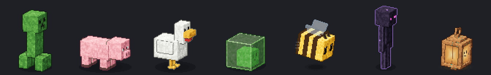

<div align="center">

[English](README.en.md) | **繁體中文**

# ⛏ Hermes × Minecraft

非官方的 Minecraft 風格 [Hermes Agent](https://github.com/NousResearch/hermes-agent) 主題：十個會動的世界、在視窗裡遊蕩的生物、跟著工作內容變化的圖示。


<sub>示意圖：插件實際畫出的背景與生物，疊在模擬頁面上錄製，不是 Hermes 實機截圖。</sub>

</div>

## 安裝與更新

**Windows（PowerShell）**

```powershell
irm https://raw.githubusercontent.com/XiaoJunX1005/hermes-minecraft-theme/main/install.ps1 | iex
```

**macOS / Linux / WSL / Git Bash**

```bash
curl -fsSL https://raw.githubusercontent.com/XiaoJunX1005/hermes-minecraft-theme/main/install.sh | bash
```

第一次安裝會套用 `minecraft` 世界和 `creeper` 寵物；之後再執行就是更新，會保留你目前的選擇。

## 世界

```bash
hermes config set display.skin minecraft-nether
```

也可以在桌面版的「外觀」設定裡選。世界預設每 4–8 分鐘自動換一次，按 Ctrl+K（⌘K）搜尋「Minecraft」可以關閉或立刻換。


| 主題名稱 | 世界 | 空島上有 |
|---|---|---|
| `minecraft` | 主世界 | 樹、小池塘、燈 |
| `minecraft-nether` | 地獄 | 熔岩池、緋紅蕈、詭異蕈、玄武岩 |
| `minecraft-end` | 終界 | 黑曜石柱與終界水晶、歌萊植物 |
| `minecraft-snow` | 雪原 | 雲杉、冰塊、燈 |
| `minecraft-cherry` | 櫻花林 | 櫻花樹、落花、池塘 |
| `minecraft-ocean` | 深海 | 沙地、海帶、珊瑚、海燈籠 |
| `minecraft-lush` | 繁茂洞穴 | 苔蘚、杜鵑、垂滴葉、發光莓 |
| `minecraft-desert` | 沙漠 | 仙人掌、枯灌木、砂岩廢墟 |
| `minecraft-mushroom` | 蘑菇島 | 菌絲土、巨型紅菇與棕菇 |
| `minecraft-deepdark` | 深暗之域 | 幽匿方塊、幽匿感測器、遠古城市柱 |

每個世界都有自己的背景場景（3 種構圖隨機）和生物，詳見 [詳細說明](docs/DETAILS.md#會動的世界)。

## 寵物

```bash
hermes pets select bee
hermes pets off          # 關閉寵物
```



| 寵物名稱 | 說明 |
|---|---|
| `creeper` | 苦力怕（預設）：四腳交替走路，失敗時膨脹、閃光、冒煙 |
| `pig` | 豬：短腿小跑、揮蹄子，失敗時頭暈冒星星 |
| `chicken` | 雞：走路時頭一伸一縮、拍翅膀，嚇到時羽毛亂飛 |
| `slime` | 史萊姆：半透明、一彈一彈地跳，看得到裡面的臉 |
| `bee` | 蜜蜂：半透明翅膀一直拍，揮手時跳搖擺舞，跳躍時翻滾 |
| `enderman` | 終界使者：紫色眼睛，跳躍時傳送，等待時抱著草方塊 |
| `lantern` | 原創小燈籠：發光的玻璃臉，提把會晃，失敗時熄滅再點亮 |

左右走路各 16 格、其他動作各 6 格。建議在桌面版把寵物大小調到 0.6 左右，細節比較清楚。

## 活動圖示


由隨附的桌面版插件提供，讀取桌面版收到的工作事件（哪個工具開始、結束，是否在等你核准），不讀取對話內容。圖示會出現在兩個地方：

- **底部狀態列**：圖示加上文字，例如「讀取檔案」；同時跑多個工具時會顯示「×2」。
- **對話中的「思考中」那一列**：換成對應的圖示。

| 圖示 | 顯示時機 |
|---|---|
| 附魔書 | 思考中（還沒開始回答） |
| 羽毛筆 | 正在寫回覆 |
| 熔爐 | 執行終端機指令、跑程式 |
| 指南針 | 搜尋網路 |
| 藏寶圖 | 讀取網頁、操作瀏覽器 |
| 翻頁的書 | 讀取檔案、技能 |
| 火把 | 搜尋專案檔案 |
| 鐵砧 | 新增或修改檔案 |
| 望遠鏡 | 看圖、看畫面 |
| 寶箱 | 記憶、待辦清單、排程 |
| 蜜蜂 | 派出子代理 |
| 沙漏 | 等你核准或回答問題 |
| TNT | 出錯（顯示 3 秒） |
| 經驗球 | 完成（顯示 1.5 秒） |
| 鎬子 | 其他工具（例如 MCP 工具） |

## 惹毛蜜蜂


8 秒內用滑鼠靠近同一隻蜜蜂再離開 3 次，牠會生氣衝向游標，刺一下後彈開逃走。只是畫面效果，不影響滑鼠或點擊。規則細節見 [詳細說明](docs/DETAILS.md#會動的世界)。

## 還原

```bash
hermes config set display.skin default
hermes pets off
```

## 授權

- 程式碼與自行繪製的圖像：MIT，見 [LICENSE](LICENSE)。
- 字型 [Zpix](https://github.com/SolidZORO/zpix-pixel-font)：**個人與教育用途免費，商業用途需向作者購買授權**。本專案只透過 CDN 載入，不附帶字型檔。
- 非官方粉絲作品，與 Mojang Studios、Microsoft 無關。Minecraft 是 Mojang Synergies AB 的商標。

<sub>想自己修改或重新產生素材：[開發說明](docs/DEVELOPMENT.md)</sub>
