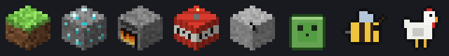

<div align="center">

# ⛏ Hermes × Minecraft 主題

非官方的 Minecraft 風格 [Hermes Agent](https://github.com/NousResearch/hermes-agent) 主題，含 5 個世界、10 隻寵物與像素字型。


<sub>上圖是用主題實際的 CSS 套在模擬頁面上錄製的示意圖，不是 Hermes 實機截圖。</sub>

</div>

## 內容

- **5 個世界主題**：主世界、地獄、終界、雪原、櫻花林。每個世界有自己的漂浮空島、主色、星空顏色、首頁標語與底部地表條。
- **像素字型**：使用 [Zpix](https://github.com/SolidZORO/zpix-pixel-font)，中文、英文、數字都是點陣字。字型從網路載入，連不上時會改用微軟正黑體。
- **思考中圖示**：8 種會動的方塊與生物，不同回合會顯示不同圖示。
- **10 隻寵物**：4 種苦力怕、豬、雞、史萊姆、蜜蜂、終界使者，以及原創的小燈籠。每隻都有 9 種動作（待機、跑步、開心、跳躍、失敗、等待、閱讀等）。
- **其他介面細節**：石頭質感按鈕、經驗值條（回覆中顯示）、方塊雲、附魔光澤的訊息泡泡。

動畫效果主要在**桌面版**。終端機版（CLI / TUI）會套用配色、Logo、提示文字與寵物（終端機支援時）。

## 安裝與更新

**Windows（PowerShell）**

```powershell
irm https://raw.githubusercontent.com/XiaoJunX1005/hermes-minecraft-theme/main/install.ps1 | iex
```

**macOS / Linux / WSL / Git Bash**

```bash
curl -fsSL https://raw.githubusercontent.com/XiaoJunX1005/hermes-minecraft-theme/main/install.sh | bash
```

安裝程式會：

1. 把所有主題與寵物先下載到暫存資料夾，全部成功後才更新到 Hermes 的資料夾（下載失敗不會動到現有檔案）。
2. 第一次安裝時套用 `minecraft` 主題與 `creeper-blocky` 寵物。
3. 之後再執行就是**更新**，會保留你目前選的世界與寵物。

安裝時想直接指定，可以先設定環境變數：

```powershell
$env:HMT_SKIN = 'minecraft-end'; $env:HMT_PET = 'mc-bee'
irm https://raw.githubusercontent.com/XiaoJunX1005/hermes-minecraft-theme/main/install.ps1 | iex
```

## 切換世界

```bash
hermes config set display.skin minecraft-nether
```

也可以在桌面版的「外觀」設定直接選。


| 主題名稱 | 世界 | 空島上有 |
|---|---|---|
| `minecraft` | 主世界 | 樹、小池塘、燈 |
| `minecraft-nether` | 地獄 | 熔岩池、緋紅蕈、詭異蕈、玄武岩 |
| `minecraft-end` | 終界 | 黑曜石柱與終界水晶、歌萊植物 |
| `minecraft-snow` | 雪原 | 雲杉、冰塊、燈 |
| `minecraft-cherry` | 櫻花林 | 櫻花樹、落花、池塘 |

## 切換寵物

```bash
hermes pets select mc-bee
hermes pets off          # 關閉寵物
```


| 寵物名稱 | 說明 |
|---|---|
| `creeper-blocky` | 苦力怕：方正 Q 版（預設） |
| `creeper-carved` | 苦力怕：稜角分明、臉部內凹 |
| `creeper-tall` | 苦力怕：接近遊戲比例 |
| `creeper-buddy` | 苦力怕：圓潤 Q 版，有腮紅 |
| `mc-pig` | 豬 |
| `mc-chicken` | 雞 |
| `mc-slime` | 史萊姆 |
| `mc-bee` | 蜜蜂 |
| `mc-enderman` | 終界使者 |
| `lantern-buddy` | 原創小燈籠 |

## 思考中圖示



草方塊、鑽石礦、熔爐、TNT、挖掘中的石頭、史萊姆、蜜蜂、雞，依對話中的訊息順序輪流出現，不是隨機，也不是依 Hermes 正在做的事決定。

## 用另一台電腦連線使用

如果筆電是透過桌面版連到桌電的 Hermes：

- 畫面的配色與動畫由**桌電**提供。
- 要改主題或寵物，請在**桌電**安裝或切換，然後重新開啟筆電的 Hermes 桌面版（或重新連線），讓它重新讀取清單。
- 如果筆電重新開啟後主題有更新、寵物清單卻還是舊的，請在**筆電**也執行一次上面的安裝指令。

## 還原

```bash
hermes config set display.skin default
hermes pets off
```

## 開發

素材全部由 `tools/` 裡的 Python 程式產生，需要 Python 3.10 以上與 Pillow。請修改 `src/` 或 `tools/`，不要直接改 `skins/*.yaml`（那是產生出來的檔案）。

```bash
pip install pillow
python tools/make_creeper.py      # 苦力怕 → pets/creeper-*/、docs/creepers.gif
python tools/make_mobs.py         # 其他生物 → pets/mc-*/、docs/mobs.gif
python tools/make_lantern.py      # 小燈籠 → pets/lantern-buddy/
python tools/build_skin.py        # 5 個世界 → skins/*.yaml、docs/islands.gif、docs/thinking.gif
python tools/build_skin.py --install                 # 產生並安裝到本機，保留目前的選擇
python tools/build_skin.py --install --skin=minecraft-end --pet=mc-bee
python tools/make_preview.py && python tools/record_gif.py   # 預覽頁與 docs/preview.gif（需要 Chrome 或 Edge）
```

| 檔案 | 用途 |
|---|---|
| `src/skin.base.yaml` | 配色、終端機提示文字、品牌文字 |
| `src/desktop.css` | 桌面版樣式與動畫（`{{...}}` 由 build 依世界填入） |
| `tools/voxel.py` | 5 種空島與渲染器 |
| `tools/make_icons.py` | 思考中圖示 |
| `tools/pixels.py` | 草地、泥土等材質 |

Hermes 對主題內嵌 CSS 有 32 KiB 上限，目前每個世界約 30 KiB；超過時 `build_skin.py` 會直接報錯。另一版極簡風格「Voxel Lantern」保留在 git tag `voxel-lantern`。

## 授權

- 程式碼與本專案自行繪製的圖像：MIT，見 [LICENSE](LICENSE)。
- Zpix 字型：由原作者授權，**個人與教育用途免費，商業用途需另外購買授權**，詳見 [Zpix 專案](https://github.com/SolidZORO/zpix-pixel-font)。本專案只以 CDN 連結載入，不附帶字型檔。
- 本專案為非官方粉絲作品，與 Mojang Studios、Microsoft 無關。Minecraft 是 Mojang Synergies AB 的商標。
