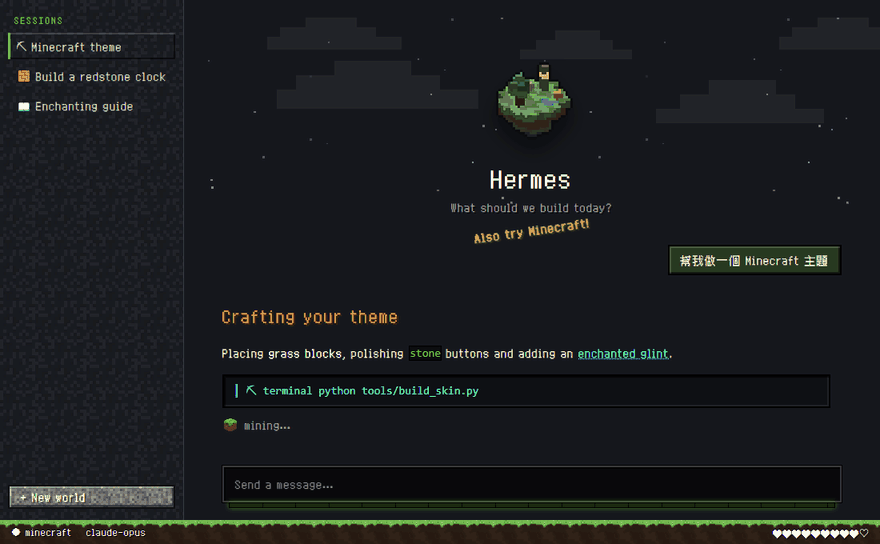
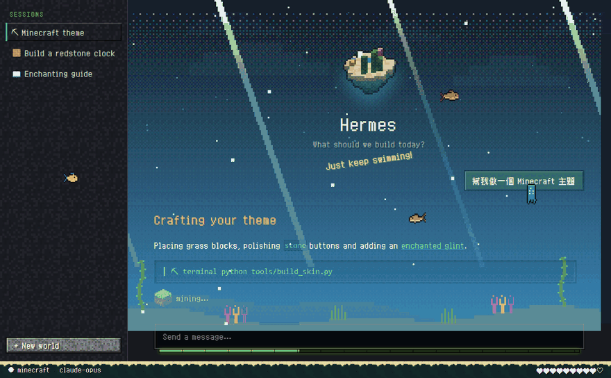

<div align="center">

# ⛏ Hermes × Minecraft 主題

非官方的 Minecraft 風格 [Hermes Agent](https://github.com/NousResearch/hermes-agent) 主題，含 10 個世界、10 隻寵物與像素字型。



<sub>上圖是用主題實際的 CSS 套在模擬頁面上錄製的示意圖，不是 Hermes 實機截圖。</sub>

</div>

## 內容

- **10 個世界主題**：主世界、地獄、終界、雪原、櫻花林、深海、繁茂洞穴、沙漠、蘑菇島、深暗之域。每個世界有自己的漂浮空島、主色、星空顏色、首頁標語與底部地表條。
- **像素字型**：使用 [Zpix](https://github.com/SolidZORO/zpix-pixel-font)，中文、英文、數字都是點陣字。字型從網路載入，連不上時會改用微軟正黑體。
- **活動圖示**：依 Hermes 正在做的事（思考、讀檔、執行指令、搜尋網路、等你回應…）顯示對應的動畫圖示與文字。
- **10 隻寵物**：4 種苦力怕、豬、雞、史萊姆、蜜蜂、終界使者，以及原創的小燈籠。每隻都有 9 種動作（待機、跑步、開心、跳躍、失敗、等待、閱讀等）。
- **其他介面細節**：石頭質感按鈕、經驗值條（回覆中顯示）、方塊雲、附魔光澤的訊息泡泡。

動畫效果主要在**桌面版**。終端機版（CLI / TUI）會套用配色、Logo、提示文字與寵物（終端機支援時）。

## 安裝與更新

**Windows（PowerShell）**

```powershell
irm https://raw.githubusercontent.com/XiaoJunX1005/hermes-minecraft-theme/main/install.ps1 | iex
```

**macOS / Linux / WSL / Git Bash**

```bash
curl -fsSL https://raw.githubusercontent.com/XiaoJunX1005/hermes-minecraft-theme/main/install.sh | bash
```

安裝程式會：

1. 把所有主題、寵物與活動圖示插件先下載到暫存資料夾，全部成功後才更新到 Hermes 的資料夾（下載失敗不會動到現有檔案）。
2. 第一次安裝時套用 `minecraft` 主題與 `creeper-blocky` 寵物。
3. 之後再執行就是**更新**，會保留你目前選的世界與寵物。

安裝時想直接指定，可以先設定環境變數：

```powershell
$env:HMT_SKIN = 'minecraft-end'; $env:HMT_PET = 'mc-bee'
irm https://raw.githubusercontent.com/XiaoJunX1005/hermes-minecraft-theme/main/install.ps1 | iex
```

## 切換世界

```bash
hermes config set display.skin minecraft-nether
```

也可以在桌面版的「外觀」設定直接選。


| 主題名稱 | 世界 | 空島上有 |
|---|---|---|
| `minecraft` | 主世界 | 樹、小池塘、燈 |
| `minecraft-nether` | 地獄 | 熔岩池、緋紅蕈、詭異蕈、玄武岩 |
| `minecraft-end` | 終界 | 黑曜石柱與終界水晶、歌萊植物 |
| `minecraft-snow` | 雪原 | 雲杉、冰塊、燈 |
| `minecraft-cherry` | 櫻花林 | 櫻花樹、落花、池塘 |
| `minecraft-ocean` | 深海 | 沙地、海帶、珊瑚、海燈籠 |
| `minecraft-lush` | 繁茂洞穴 | 苔蘚、杜鵑、垂滴葉、發光莓 |
| `minecraft-desert` | 沙漠 | 仙人掌、枯灌木、砂岩廢墟 |
| `minecraft-mushroom` | 蘑菇島 | 菌絲土、巨型紅菇與棕菇 |
| `minecraft-deepdark` | 深暗之域 | 幽匿方塊、幽匿感測器、遠古城市柱 |

## 切換寵物

```bash
hermes pets select mc-bee
hermes pets off          # 關閉寵物
```


| 寵物名稱 | 說明 |
|---|---|
| `creeper-blocky` | 苦力怕：方正 Q 版（預設） |
| `creeper-carved` | 苦力怕：稜角分明、臉部內凹 |
| `creeper-tall` | 苦力怕：接近遊戲比例 |
| `creeper-buddy` | 苦力怕：圓潤 Q 版，有腮紅 |
| `mc-pig` | 豬 |
| `mc-chicken` | 雞 |
| `mc-slime` | 史萊姆 |
| `mc-bee` | 蜜蜂 |
| `mc-enderman` | 終界使者 |
| `lantern-buddy` | 原創小燈籠 |

## 活動圖示


由隨附的桌面版插件 `minecraft-activity` 提供。它讀取桌面版收到的工作事件（哪個工具開始、結束，是否在等你核准），不讀取對話內容。圖示會出現在兩個地方：

- **底部狀態列**：圖示加上文字，例如「讀取檔案」；同時跑多個工具時會顯示「×2」。
- **對話中的「思考中」那一列**：換成對應的圖示。

| 圖示 | 顯示時機 |
|---|---|
| 附魔書 | 思考中（還沒開始回答） |
| 羽毛筆 | 正在寫回覆 |
| 熔爐 | 執行終端機指令、跑程式 |
| 指南針 | 搜尋網路 |
| 藏寶圖 | 讀取網頁、操作瀏覽器 |
| 翻頁的書 | 讀取檔案、技能 |
| 火把 | 搜尋專案檔案 |
| 鐵砧 | 新增或修改檔案 |
| 望遠鏡 | 看圖、看畫面 |
| 寶箱 | 記憶、待辦清單、排程 |
| 蜜蜂 | 派出子代理 |
| 沙漏 | 等你核准或回答問題 |
| TNT | 出錯（顯示 3 秒） |
| 經驗球 | 完成（顯示 1.5 秒） |
| 鎬子 | 其他工具（例如 MCP 工具） |

### 會動的世界




<sub>示意圖：插件實際畫出的背景與生物，疊在模擬頁面上錄製（主世界、櫻花林、雪原、地獄、終界）。</sub>

**背景**：對話區後面有一層會動的像素場景，淡淡疊在背景上，地平線上有該區域的地標：

| 世界 | 背景 |
|---|---|
| 主世界 | 緩慢捲動的山丘、橡樹、白樺、花叢、螢火蟲 |
| 櫻花林 | 粉色山丘、櫻花樹、飄落的花瓣 |
| 雪原 | 雪山、雲杉、冰屋、遠近兩層飄雪 |
| 地獄 | 玄武岩柱、緋紅蕈與詭異蕈、底部熔岩光、往上飄的火星 |
| 終界 | 兩種場景（見下方） |
| 深海 | 海床、海帶、海草、珊瑚、斜射的光束、上升的氣泡 |
| 繁茂洞穴 | 洞頂垂下藤蔓與發光莓、杜鵑、垂滴葉、飄落的孢子 |
| 沙漠 | 沙丘、仙人掌、枯灌木、沙漠神殿、橫吹的飛沙 |
| 蘑菇島 | 菌絲土丘、巨型紅菇與棕菇、飄浮孢子 |
| 深暗之域 | 幽匿感測器、尖嘯器、遠古城市牆、地面擴散的青色幽匿波紋 |

**終界**每次進入時決定是哪一種，待在終界期間不會變：

- **終界本島**：終界龍會出現；地面是終界石，有一排黑曜石柱（兩根有鐵柵），柱頂的終界水晶會閃，中央有返回傳送門。
- **外島**：沒有終界龍；幾座固定的浮島（只會輕輕上下浮動），有歌萊樹和一座終界城。島上坐著 2–4 隻**界伏蚌**：平常不動，偶爾開殼探頭；滑鼠在牠附近停一下，牠會合殼、冒紫色粒子，傳送到另一座島的空位（其他島都滿了才會留在同一座島），之後幾秒內不會再傳送。

**生物**：會飛的在整個視窗裡飛、魚在畫面裡平游、陸地生物沿著底部狀態列（草地條）走；主世界、櫻花林 2–5 隻，雪原、地獄 2–4 隻，深海 3–6 隻；每隔一兩分鐘會有一隻飛走或新的一隻飛進來。

| 世界 | 可能出現 |
|---|---|
| 主世界 | 蜜蜂（一般／帶花粉／生氣）、悅靈、鸚鵡（紅／藍／綠） |
| 櫻花林 | 蜜蜂（一般／帶花粉）、悅靈、鸚鵡（青／灰） |
| 雪原 | 悅靈、蝙蝠、夜魅 |
| 地獄 | 地獄幽靈、烈焰使者 |
| 終界 | 本島：終界龍（有時加一隻夜魅）；外島：界伏蚌（有時加一隻夜魅） |
| 深海 | 鱈魚、鮭魚、熱帶魚（橘／黃／藍）、魷魚、發光魷魚 |
| 繁茂洞穴 | 美西螈（粉／藍，在地面爬）、蝙蝠 |
| 沙漠 | 兔子（金／棕，會跳）、駱駝 |
| 蘑菇島 | 哞菇（紅／棕） |
| 深暗之域 | 伏守者（慢慢走、很少見）、蝙蝠 |

- 每種生物動法不同：蜜蜂短距離飛、常停下；夜魅和終界龍大弧度滑翔；地獄幽靈慢慢飄。
- 往反方向飛時會先轉成正面再轉過去；停下來一陣子會轉頭看你。
- 滑鼠靠近會躲開；Hermes 工作時飛得比較快，完成時會跳一下。

### 自動換世界

每隔隨機 4–8 分鐘，畫面會用方塊轉場換到另一個世界（十個世界輪流，不會連續重複）。換的是空島、地表條、星空、背景場景和生物。

- 開關：⌘K（Ctrl+K）搜尋「Minecraft：自動換世界」；「Minecraft：現在換一個世界」可立刻換。預設開啟。
- 只在這台電腦的畫面上換，不會改 Hermes 的主題設定；你手動換主題時，以你選的為準並重新計時。
- 介面配色（按鈕、強調色）維持你選的主題。
- 系統開啟「減少動態效果」時，直接切換、不播轉場。

只有套用 `minecraft` 系列主題時才會顯示。沒有安裝插件時，「思考中」那一列會改用主題內建的 8 種圖示依訊息順序輪流顯示。

## 用另一台電腦連線使用

如果筆電是透過桌面版連到桌電的 Hermes：

- 畫面的配色與動畫由**桌電**提供。
- **活動圖示插件是在每台電腦的桌面版裡執行的**，筆電要顯示活動圖示，需要在筆電也執行一次安裝指令。
- 要改主題或寵物，請在**桌電**安裝或切換，然後重新開啟筆電的 Hermes 桌面版（或重新連線），讓它重新讀取清單。
- 如果筆電重新開啟後主題有更新、寵物清單卻還是舊的，請在**筆電**也執行一次上面的安裝指令。

## 還原

```bash
hermes config set display.skin default
hermes pets off
```

## 開發

素材全部由 `tools/` 裡的 Python 程式產生，需要 Python 3.10 以上與 Pillow。請修改 `src/` 或 `tools/`，不要直接改 `skins/*.yaml`（那是產生出來的檔案）。

```bash
pip install pillow
python tools/make_creeper.py      # 苦力怕 → pets/creeper-*/、docs/creepers.gif
python tools/make_mobs.py         # 其他生物 → pets/mc-*/、docs/mobs.gif
python tools/make_lantern.py      # 小燈籠 → pets/lantern-buddy/
python tools/make_activity.py     # 活動圖示 → desktop-plugins/minecraft-activity/plugin.js、docs/activity.gif
python tools/build_skin.py        # 5 個世界 → skins/*.yaml、docs/islands.gif、docs/thinking.gif
python tools/build_skin.py --install                 # 產生並安裝到本機，保留目前的選擇
python tools/build_skin.py --install --skin=minecraft-end --pet=mc-bee
python tools/make_preview.py && python tools/record_gif.py   # 預覽頁與 docs/preview.gif（需要 Chrome 或 Edge）
```

| 檔案 | 用途 |
|---|---|
| `src/skin.base.yaml` | 配色、終端機提示文字、品牌文字 |
| `src/desktop.css` | 桌面版樣式與動畫（`{{...}}` 由 build 依世界填入） |
| `tools/voxel.py` | 5 種空島與渲染器 |
| `tools/make_icons.py` | 主題內建的思考中圖示（無插件時使用） |
| `src/activity-plugin.js` | 活動圖示插件原始碼（`make_activity.py` 會把圖嵌入並輸出到 `desktop-plugins/`） |
| `tools/pixels.py` | 草地、泥土等材質 |
| `tools/critters_art.py` | 飛行生物與界伏蚌的像素圖 |
| `tools/scene_art.py` | 背景地標（樹、冰屋、蕈、終界城、水晶、傳送門） |

Hermes 對主題內嵌 CSS 有 32 KiB 上限，目前每個世界約 30 KiB；超過時 `build_skin.py` 會直接報錯。另一版極簡風格「Voxel Lantern」保留在 git tag `voxel-lantern`。

## 授權

- 程式碼與本專案自行繪製的圖像：MIT，見 [LICENSE](LICENSE)。
- Zpix 字型：由原作者授權，**個人與教育用途免費，商業用途需另外購買授權**，詳見 [Zpix 專案](https://github.com/SolidZORO/zpix-pixel-font)。本專案只以 CDN 連結載入，不附帶字型檔。
- 本專案為非官方粉絲作品，與 Mojang Studios、Microsoft 無關。Minecraft 是 Mojang Synergies AB 的商標。
