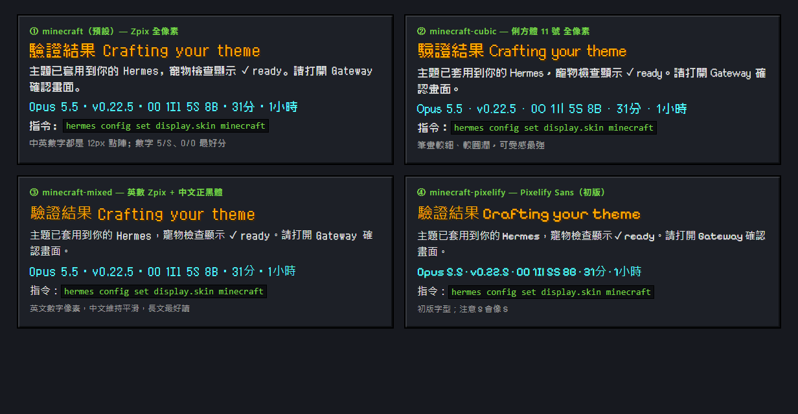

<div align="center">

# ⛏ Hermes × Minecraft Theme

**Minecraft 風格、會動的 [Hermes Agent](https://github.com/NousResearch/hermes-agent) 主題（桌面版 / TUI / CLI）**


<sub>預覽圖是用真實主題 CSS 套在模擬頁面上錄的示意圖。</sub>

</div>

## ✨ 特色

| | 動畫 / 效果 |
|---|---|
| 🧱 **旋轉草方塊** | 新對話畫面中央的 3D 草方塊旋轉、漂浮；32×32 高細節紋理（柔和噪點、圓潤草緣、小石子），不是原版 16×16 |
| 🌌 **夜空** | 上方有星星與緩慢飄動的方塊雲 |
| 🟩 **經驗值條** | Hermes 回覆時輸入框下方跑 XP 條 |
| ⛏ **挖礦中…** | 「思考中」換成迷你旋轉方塊 |
| 💜 **附魔光澤** | 你的訊息泡泡有紫色附魔光掃過 |
| 🌱 **草地狀態列** | 高細節草地條，文字加黑邊確保看得清楚 |
| 🪨 **石頭按鈕** | 石材紋理 + 立體斜角，滑過變藍底黃字 |
| 🔤 **像素字型（中英皆可）** | 4 款可選，見下方 |
| 🐸 **Creeper Buddy** | 重新繪製的 Q 版苦力怕（4× 像素密度、柔和光影、眨眼、腮紅），9 種動畫狀態 |
| 🏮 **Lantern Buddy** | 另一隻原創小燈籠寵物，可切換 |

<div align="center">


</div>

## 🔤 字型選擇



| 主題名稱 | 字型 | 特色 |
|---|---|---|
| `minecraft`（預設） | [Zpix 最像素](https://github.com/SolidZORO/zpix-pixel-font) | 中英數字全 12px 點陣，數字 5/S、0/O 最好分 |
| `minecraft-cubic` | [俐方體 11 號 Cubic 11](https://github.com/ACh-K/Cubic-11) | 筆畫較細圓，可愛感最強 |
| `minecraft-mixed` | Zpix（英數）+ 微軟正黑體（中文） | 英數像素、中文平滑，長文最好讀 |
| `minecraft-pixelify` | [Pixelify Sans](https://fonts.google.com/specimen/Pixelify+Sans) + 正黑體 | 初版字型（5 容易看成 S） |

切換：`hermes config set display.skin minecraft-cubic`（或在 Appearance 直接選），一秒內即時換。
字型從 jsDelivr / Google Fonts 線上載入；離線時會自動回退成微軟正黑體。

## 📦 安裝

```powershell
irm https://raw.githubusercontent.com/XiaoJunX1005/hermes-minecraft-theme/main/install.ps1 | iex
```

```bash
curl -fsSL https://raw.githubusercontent.com/XiaoJunX1005/hermes-minecraft-theme/main/install.sh | bash
```

手動：把 `skins/*.yaml` 複製到 Hermes home 的 `skins/`（Windows：`%LOCALAPPDATA%\hermes\skins\`），`pets/*` 複製到 `pets/`，然後：

```bash
hermes config set display.skin minecraft
hermes pets select creeper-buddy     # 或 lantern-buddy
```

**還原：** `hermes config set display.skin default`，寵物 `hermes pets off`。

## 🛠 開發

```
src/skin.base.yaml      調色盤、spinner、品牌文字、tool emoji
src/desktop.css         桌面版 customCSS（{{font_*}} 由 build 填入）
tools/pixels.py         紋理（含 32×32 高細節草地 / 泥土）
tools/build_skin.py     → skins/*.yaml（4 種字型）+ docs/grass-block.gif
tools/make_creeper.py   → pets/creeper-buddy/ + docs/pet-preview.gif
tools/make_lantern.py   → pets/lantern-buddy/ + docs/lantern-preview.gif
tools/make_preview.py   → docs/preview.html；tools/record_gif.py → docs/preview.gif
docs/fonts.html         字型對照頁
```

```bash
pip install pillow
python tools/make_creeper.py
python tools/build_skin.py --install            # 預設 minecraft
python tools/build_skin.py --install --skin=minecraft-mixed
```

另一版極簡「Voxel Lantern」風格保留在 git tag `voxel-lantern`。

## 📄 License

程式碼 MIT。字型屬各自作者與授權（皆以 CDN 連結載入，未隨附）。非官方粉絲作品，與 Mojang / Microsoft 無關；*Minecraft* 是 Mojang Synergies AB 的商標。
