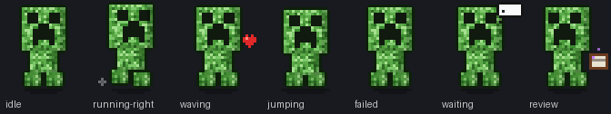
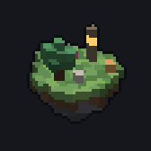

<div align="center">

# ▣ Hermes · Voxel Lantern

**原創方塊像素風、會動的 [Hermes Agent](https://github.com/NousResearch/hermes-agent) 主題**
An original, animated voxel-pixel skin for Hermes Agent — desktop app, TUI and CLI from one file.


<sub>預覽圖是用真實主題 CSS 套在模擬頁面上錄的示意圖。</sub>

</div>

## ✨ 特色 Features

| | 效果 |
|---|---|
| 🏝 **漂浮小島** | 新對話畫面中央有一座會慢慢旋轉、上下漂浮的體素小島（樹 + 發光燈籠），純 Python 光線投射算出的像素畫 |
| ✨ **淡淡星空** | 只在畫面最上方有幾顆很淡的星星緩慢飄移，不會干擾閱讀 |
| ▪▪▪ **思考中** | 三個小方塊輪流亮起 |
| ━ **回覆中** | 輸入框上緣有一道銅綠→琥珀的細光掃過 |
| 🧱 **方塊邊** | 底部狀態列頂端一條苔綠 / 銅綠的方塊細邊 |
| 🎨 **夜色調色盤** | 深板岩底、暖白文字、銅綠主色、燈籠琥珀標題 |
| 🏮 **Lantern Buddy 寵物** | 原創小燈籠：待機發光、跑步揚塵、工作時冒火花、揮手、跳躍、失敗時燈熄冒煙、等待打瞌睡、看卷軸 |
| 💻 **CLI / TUI** | 琥珀→銅綠漸層 Logo、燈籠頭像、「lighting lanterns / stacking blocks…」 |

內文、側欄、輸入框都維持介面原本的字型，中文與數字清楚好讀。所有圖都是程式產生的原創像素畫。

<div align="center">





</div>

## 📦 安裝 Install

**Windows PowerShell**

```powershell
irm https://raw.githubusercontent.com/XiaoJunX1005/hermes-minecraft-theme/main/install.ps1 | iex
```

**macOS / Linux / WSL / Git Bash**

```bash
curl -fsSL https://raw.githubusercontent.com/XiaoJunX1005/hermes-minecraft-theme/main/install.sh | bash
```

**手動**

1. 把 [`skins/minecraft.yaml`](skins/minecraft.yaml) 複製到 Hermes home 的 `skins/`
   - Windows：`%LOCALAPPDATA%\hermes\skins\`
   - macOS / Linux：`~/.hermes/skins/`
2. （可選）把 [`pets/lantern-buddy/`](pets/lantern-buddy) 複製到 `pets/`
3. 套用：

```bash
hermes config set display.skin minecraft
hermes pets select lantern-buddy   # 可選
```

> 檔名保留 `minecraft` 是為了相容既有設定；視覺已改為原創的 Voxel Lantern 風格。

**還原：** `hermes config set display.skin default`，寵物 `hermes pets off`。

### 遠端連線（筆電透過 gateway 連桌電）

主題裝在**主機（桌電）**的 Hermes home 就好，遠端連進來的桌面 App 也會套用（實測筆電遠端畫面有吃到主題 CSS）。

## 🛠 開發 Development

請改 `src/`，不要直接改 `skins/minecraft.yaml`：

```
src/skin.base.yaml     調色盤、spinner、品牌文字、tool emoji
src/desktop.css        桌面版 customCSS（動畫都在這裡）
tools/pixels.py        共用調色盤
tools/voxel.py         體素小島 + 光線投射渲染器
tools/build_skin.py    → skins/minecraft.yaml + docs/island.gif
tools/make_pet.py      → pets/lantern-buddy/ + docs/pet-preview.gif
tools/make_preview.py  → docs/preview.html（瀏覽器直接開來看）
tools/record_gif.py    → docs/preview.gif（需要 Chrome 或 Edge）
```

```bash
pip install pillow
python tools/make_pet.py
python tools/build_skin.py --install   # 產生、安裝並立即套用
python tools/make_preview.py && python tools/record_gif.py
```

`customCSS` 有 32 KiB 上限，`build_skin.py` 超過時會直接報錯；系統開啟「減少動態效果」時動畫會停止。

## 📄 License

MIT © 2026。非官方作品，與 Mojang / Microsoft 無關。
