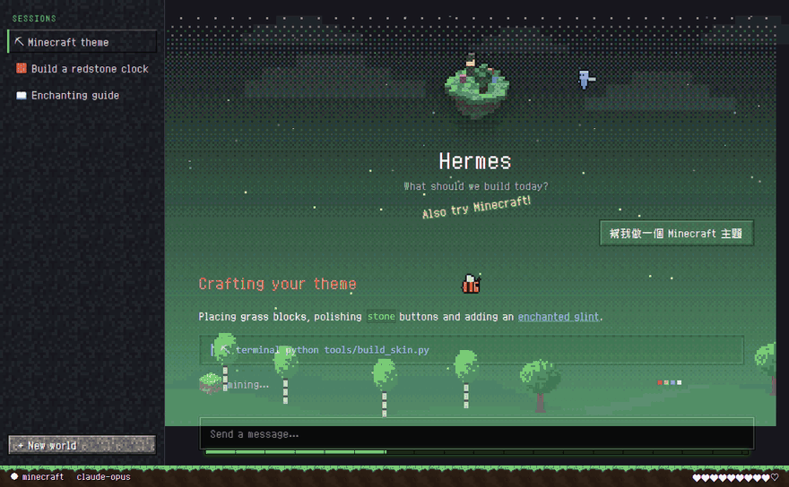

# 詳細說明

[← 回到 README](../README.md)（[English](../README.en.md)）

README 已列出世界、寵物與活動圖示；這裡是背景場景、生物和自動換世界的細節。

## 會動的世界

示意圖：插件實際畫出的背景與生物，疊在模擬頁面上錄製。

**背景**：對話區後面有一層會動的像素場景，淡淡疊在背景上。每個世界有 3 種構圖，每次進入世界時隨機選一種（待在同一個世界期間不變），樹和地標的造型、疏密、遠近兩層也會跟著變：

| 世界 | 背景 |
|---|---|
| 主世界 | 花草原／橡樹林／白樺林；螢火蟲 |
| 櫻花林 | 草坡／密林／池畔；飄落的花瓣 |
| 雪原 | 雲杉林／冰原與冰屋／雪山；兩層飄雪 |
| 地獄 | 緋紅森林（巨型緋紅蕈、垂泣藤）／詭異森林（巨型詭異蕈、纏怨藤）／玄武岩三角洲（落灰）；熔岩光 |
| 終界 | 本島或外島（見下方），柱子數量與外島排列每次不同 |
| 深海 | 海帶林（綠色深水、密集高海帶）／珊瑚礁（亮青色、大片彩色礁群）／沙地（大片空曠沙床、稀疏海草）；氣泡 |
| 繁茂洞穴 | 雙水池／垂滴葉（中央一個大水池、密集葉台）／杜鵑樹（角落小水池、杜鵑樹叢、發光莓洞頂）；每種都有水池讓美西螈上下岸 |
| 沙漠 | 沙丘／沙漠神殿／平原；飛沙 |
| 蘑菇島 | 巨菇林／開闊菌絲地／棕菇群；孢子 |
| 深暗之域 | 遠古城市（青色亮邊的城牆與斷柱）／幽匿蔓延（平地、大量感測器與尖嘯器）／鐘乳石洞（洞頂鐘乳石、地勢起伏）；幽匿波紋 |

**終界**每次進入時決定是哪一種，待在終界期間不會變：

- **終界本島**：終界龍會出現；地面是終界石，有 5–7 根深色黑曜石柱（兩根有鐵柵），柱頂的終界水晶會閃，中央有返回傳送門。柱子是半透明的深色實心柱，柱子後面的文字會變暗但還看得到。
- **外島**：沒有終界龍；幾座固定的浮島（只會輕輕上下浮動），有歌萊樹和一座終界城。島上坐著 2–4 隻**界伏蚌**：平常不動，偶爾開殼探頭；滑鼠在牠附近停一下，牠會合殼、冒紫色粒子，傳送到另一座島的空位（其他島都滿了才會留在同一座島），之後幾秒內不會再傳送。

**生物**：會飛的在整個視窗裡飛、魚在畫面裡平游、陸地生物沿著底部狀態列（草地條）走；主世界、櫻花林 2–5 隻，雪原、地獄 2–4 隻，深海 3–6 隻；每隔一兩分鐘會有一隻飛走或新的一隻飛進來。

| 世界 | 可能出現 |
|---|---|
| 主世界 | 蜜蜂（一般／帶花粉／生氣）、悅靈、鸚鵡（紅／藍／綠） |
| 櫻花林 | 蜜蜂（一般／帶花粉）、悅靈、鸚鵡（青／灰） |
| 雪原 | 悅靈、蝙蝠、夜魅 |
| 地獄 | 地獄幽靈、烈焰使者 |
| 終界 | 本島：終界龍（有時加一隻夜魅）；外島：界伏蚌（有時加一隻夜魅） |
| 深海 | 鱈魚、鮭魚、熱帶魚（橘／黃／藍）、魷魚、發光魷魚 |
| 繁茂洞穴 | 美西螈（粉／藍，在水池裡游，偶爾爬上岸走一段再回水裡）、蝙蝠 |
| 沙漠 | 兔子（金／棕，會跳）、駱駝 |
| 蘑菇島 | 哞菇（紅／棕） |
| 深暗之域 | 伏守者（慢慢走、會轉身、很少見）、蝙蝠 |

- 每種生物動法不同：蜜蜂短距離飛、常停下；夜魅和終界龍大弧度滑翔；地獄幽靈慢慢飄。
- 往反方向飛時會先轉成正面再轉過去；停下來一陣子會轉頭看你。
- 滑鼠靠近會躲開；Hermes 工作時飛得比較快，完成時會跳一下。

**惹毛蜜蜂**

8 秒內用滑鼠靠近同一隻蜜蜂再離開 3 次，牠會變紅、原地抖半秒，然後衝向游標；碰到後冒火花、往後彈開，再加速逃走，1.5 秒後變回原本的蜜蜂（帶花粉的還是帶花粉）。之後 15 秒內不會再生氣，同一時間最多一隻在生氣。游標停在旁邊不動不算，追 2 秒追不到就放棄；游標離開視窗、視窗隱藏或開「減少動態效果」時不會攻擊。這只是畫面效果，不會影響你的滑鼠或點擊。

## 自動換世界

左側工作階段欄的底圖也跟著世界換：主世界橡木板、櫻花林櫻花木板、雪原浮冰、地獄地獄磚、終界終界石磚、深海海晶石磚、繁茂洞穴苔蘚、沙漠砂岩、蘑菇島菌絲、深暗之域深板岩加幽匿。

每隔隨機 4–8 分鐘，畫面會用方塊轉場換到另一個世界（十個世界輪流，不會連續重複）。換的是空島、地表條、星空、背景場景和生物。

- 開關：⌘K（Ctrl+K）搜尋「Minecraft：自動換世界」；「Minecraft：現在換一個世界」可立刻換。預設開啟。
- 只在這台電腦的畫面上換，不會改 Hermes 的主題設定；你手動換主題時，以你選的為準並重新計時。
- 介面配色（按鈕、強調色）維持你選的主題。
- 系統開啟「減少動態效果」時，直接切換、不播轉場。

只有套用 `minecraft` 系列主題時才會顯示。沒有安裝插件時，「思考中」那一列會改用主題內建的 8 種圖示依訊息順序輪流顯示。
